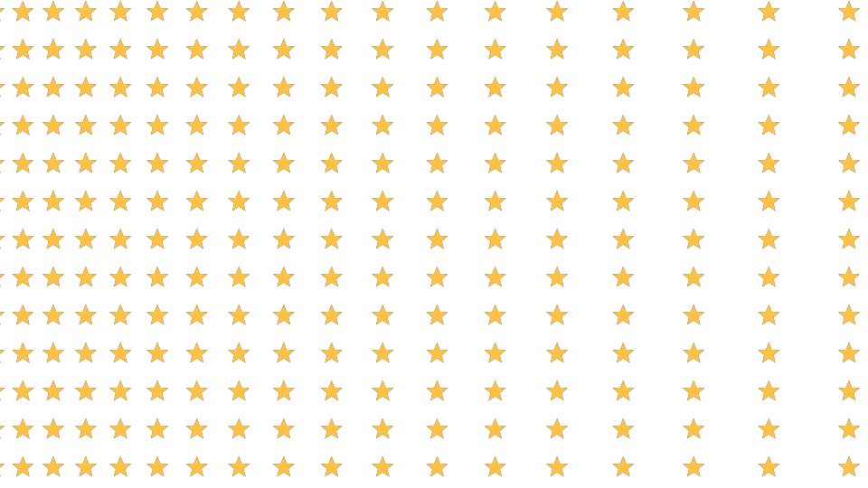

# 有序图案 1.1 · Ordered Patterns

macOS Apple Silicon 的 After Effects 原生效果插件。独立生成透明背景的规则图案阵列，不分析原画面明暗。渐变改变排列的横向间距，图形大小保持独立。

## 开发环境

- macOS + Apple Silicon，After Effects 2026。
- Apple Command Line Tools：`clang++`、macOS SDK、`Rez`、`codesign`。
- Adobe After Effects **Plug-in SDK**。SDK 保存在本机 `.local/sdk/`，不随插件源码分发。
- Python 3 用于运行构建脚本。VS Code 是可选编辑器，无需完整版 Xcode。

```sh
python3 scripts/build.py --test
python3 scripts/build.py --sdk /absolute/path/to/AfterEffectsSDK
python3 scripts/build.py --install
```

SDK 路径首次成功构建后会保存在 `.local/sdk-path.txt`；也可以设置 `AE_SDK_PATH`。VS Code 的“运行生成任务”及“运行任务”提供对应入口。

构建输出：`dist/OrderedPatterns.plugin`。默认安装到 `~/Library/Application Support/Adobe/Common/Plug-ins/7.0/MediaCore/`。更新已有插件时，旧版本会备份至项目的 `.local/backups/`。安装或更新后需重启 AE。

## 使用

1. 新建合成和一个与合成同尺寸的纯色层。
2. 给纯色层添加 **图案生成 → 有序图案** 效果。纯色层本身的颜色不参与生成。
3. 选择 `图形`：圆形、方形、菱形，或 `自定义`。
4. `密集端间距` / `稀疏端间距` 控制渐变两端的横向间距；`行间距` 独立控制行距。设置两端间距相同即可得到均匀阵列。
5. `图形大小` 独立控制尺寸；`排列角度` 旋转排列，`图形旋转` 旋转每个图形。`交错程度 (%)` 错开相邻行。
6. `渐变起点 (%)` / `渐变终点 (%)` 控制内置线性渐变范围。交换两端间距可反转疏密方向。
7. 使用自定义图形时，将透明 PNG 或预合成加入当前合成，选择 `自定义图形图层`。图形保持宽高比，尺寸指最长边。白色 `图形颜色` 保留图案本色，其他颜色与图案颜色相乘。无自定义图层时输出透明。
8. 可选的 `渐变轮廓图层` 会读取该图层中心截线上的亮度，黑色对应 Dense、白色对应 Sparse。它是**一维渐变曲线输入**，用于保持列与行有序；不会把整张二维亮度图变成半调。

图案和渐变来源层可关闭可见性；选中的图层仍作为效果输入。需要先应用其他效果或变换的图案，请先预合成。自定义素材若有大片透明留白，会影响图案视觉尺寸，建议先裁切。

## 多帧渲染

插件已声明并验证线程安全的多帧渲染支持，由 AE 调度并发帧，插件不额外创建竞争 CPU 的渲染线程。每帧的参数、图案布局和缓冲独立；图案与渐变输入在 checkout 生命周期内只读访问。

中间浮点图改为 64 行分段缓冲。3840×2160 时，每个并发帧的该项缓冲从 126.56 MiB 降至 3.75 MiB，减少约 97%；这个数字不包括 AE 自身图像、缓存或布局列表。

旧工程的内部 match name 和参数 ID 保持不变。中文菜单入口为“图案生成 → 有序图案”。

## 当前边界

- 使用 CPU，原生处理 8/16 bpc，并支持 AE 多帧渲染；32 bpc 浮点 SmartFX 和 Metal 加速尚未实现。
- 首先实现线性疏密渐变；没有径向排列、任意二维密度变形或图案集切换。
- 图形边缘使用 2×2 采样，极细笔画在小尺寸下可能闪烁。
- 为避免误设造成极大运算量，布局设置了 250,000 个候选位置的保守上限。超限会报错，不会截断画面。请增大间距。
- 尚未验证 Premiere Pro 和 Intel Mac。

## 文件

- `src/PatternCore.*`：与 AE 无关的布局及绘制核心。
- `src/OrderedPatterns.cpp`：AE 参数与像素适配。
- `resources/OrderedPatternsPiPL.r`：插件发现资源。
- `scripts/build.py`：命令行构建、签名、本机安装。
- `tests/core_test.cpp`：渐变间距、稳定布局、透明度、等比例图案与取消检查。
- `tools/preview.cpp`：独立算法预览，不代替 AE 验证。

多帧测试详情见 [MFR_VALIDATION.md](docs/MFR_VALIDATION.md)。

已在 AE 26.0 中加载并实际渲染，验证了 8/16 bpc 工程、半分辨率预览、旋转关键帧及保存后重新打开。1.1 版额外验证了两种原生位深下各 24 帧的多帧/单帧结果逐像素一致，最多 6 个不同时间帧同时执行。`examples/Ordered Patterns Demo.aep` 包含三个可直接调整的示例。


