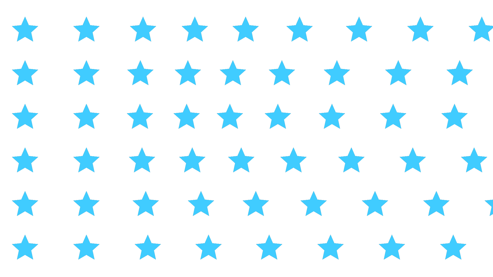

# 有序图案 2.0 · AE 实机验证

日期：2026-10-29。环境：macOS Apple Silicon，After Effects 26.0x67。

## 验证对象与工程

在启动 AE 前安装 2.0 临时诊断构建，AE 效果列表读取到版本 `2.0x0`。通过现有 CEP / JSX 桥执行测试；原生 MCP 执行平面不可用与本效果插件的 Metal 计算是不同机制，不把它当作 GPU 支持证明。

原工程 `examples/渐变图层修复.aep` 未被修改。测试在 `.local/v2-validation/scene.aep` 副本中新增独立合成：

- 1920×1080，24 fps，白色五角星预合成作为自定义来源。
- 来源画布 1920×1080，星形外半径 450、内半径 210；径向渐变预合成控制间距。
- 图形大小 330、端点间距 92 / 2、行距 40、渐变强度 79%。
- 图形旋转与水平偏移设置关键帧，避免只测静态帧缓存。
- 该测试重现大图形密集重叠的参数组合，不声称恢复了之前未保存的完整场景。

## 实际渲染与多帧结果

每个组合渲染 8 帧 PNG，开始前清理 AE 缓存。每项仅运行一次，耗时包含 AE 调度、来源合成、效果、色彩处理和 PNG 输出，不能作为稳定帧率或单独 GPU 耗时。

| 工程与 PNG 位深 | 多帧关闭，8 帧总耗时 | 多帧开启，8 帧总耗时 | 解码后的逐帧对比 |
|---|---:|---:|---|
| 8 bpc / PNG 8 位 RGBA | 3.550 秒 | 1.237 秒 | 8 / 8 帧完全一致 |
| 16 bpc / PNG 16 位 RGBA | 2.945 秒 | 2.618 秒 | 8 / 8 帧完全一致 |

四组共 32 帧均达到 `RQItemStatus.DONE`，输出文件数量、1920×1080 尺寸及 8 / 16 位 PNG 文件头检查通过。使用 `tools/compare_render_frames.cpp` 解码像素并比较，不依赖 PNG 压缩文件或时间元数据相同。

## Metal 与插件耗时

诊断日志来自真实 AE 进程 PID 70838，不是独立算法或模拟宿主程序。两种位深的多帧阶段均观察到四个不同时间帧同时处于插件渲染调用中，并记录到真实 Metal command buffer 执行时间。

串行阶段相关插件调用的中位数：

| 位深与请求 | 插件调用耗时 | Metal 计算耗时 |
|---|---:|---:|
| 8 bpc，全分辨率阶段 | 47.35 ms | 31.45 ms |
| 16 bpc，全分辨率阶段 | 58.82 ms | 45.31 ms |

每个全分辨率阶段记录了 11 次相关调用，包含队列渲染前后的查看器请求；以上不是严格剔除查看器后的逐输出帧统计。16 位多帧阶段另有一次不足 1 ms、未记录到 Metal 的辅助调用，不能仅凭该条判断回退或取消；8 个导出帧均完整且与串行像素一致。

另做 16 bpc 半分辨率单帧导出：输出确认为 960×540、16 位 RGBA，渲染队列总耗时 316 ms。对应第一条插件调用为 25.46 ms，其中 Metal 9.09 ms；随后查看器调用为 8.50 ms，其中 Metal 5.65 ms。这些数据说明插件在此类半分辨率请求中的响应，不等于整套 AE 能以该耗时持续播放。

真实数据低于此前有利模拟场景的提速倍率。尚未在同一真实 AE 场景下测旧渲染器，因此本轮不报告旧版至新版的实机提升倍数。

## 图形与透明度检查

新增稀疏排列检查合成，确认星形轮廓、比例、颜色、二维渐变改变各行间距以及 RGBA 透明输出。检查图为原生 16 位 PNG：

密集组合的重叠会使画面大部分区域被填满，保留该组合用于压力验证；稀疏图仅用于观察轮廓，不替代密集组合的性能结果。

## 日志、清理与交付

- 原始结果、分组日志与 PNG 保存在 `.local/v2-validation/`，包括 `live-summary.json`、`8-off/`、`8-on/`、`16-off/`、`16-on/`、`16-half/`、`sparse/`。
- 测试用渲染队列项已清除，队列恢复为空；测试工程保存为 16 bpc、半分辨率。
- 诊断构建留有备份，交付构建使用无日志版本，其二进制 SHA-256 为 `c99a6d80b28a42fe003c519c510628fb38faed3b1be6ff2bf0d20189cd380368`，与现有 Mac 发布 zip 中的二进制一致。
- 换回与 zip 完全一致的无日志构建并重启 AE，新的进程 PID 71250 再次读取到版本 `2.0x0`。以该构建重新导出一帧 1920×1080、16 位 RGBA PNG，状态为 DONE，解码后与诊断构建对应帧逐像素完全一致，诊断日志文件没有继续增长。
- 最终 AE 保持打开，展示测试副本中的“有序图案 2.0 · 图形检查”合成，16 bpc、半分辨率，生成器图层已选中。密集压力合成“有序图案 2.0 实机验证”也保留在同一副本中。

## 未覆盖范围

Windows / DirectX / CUDA、32 bpc / HDR、4K 长时间运行、大量彩色半透明素材和任意工作工程未在本轮实机验证。架构仍为 CPU 入口加独立 Metal 队列的混合实现，尚未接入 SmartFX GPU 原生资源与跨帧素材缓存。
